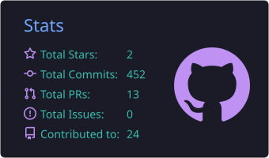
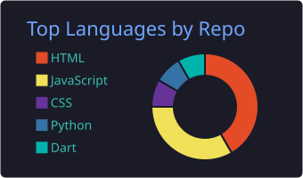
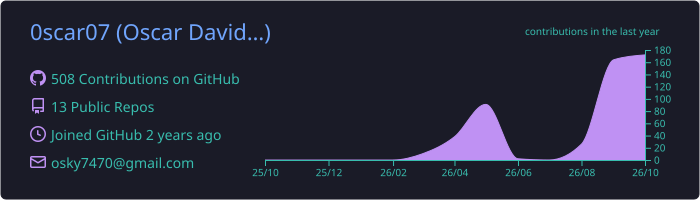

<div align="center">


# ⚡ 0scar07 ⚡


<br>


</div>

---

# 🌌 About Me

```yaml
name: Oscar David
username: 0scar07

education:
  university: Universidad Simón Bolívar
  career: Systems Engineering

located_in: Colombia 🇨🇴

current_focus:
  [
    "Artificial Intelligence",
    "Machine Learning",
    "TensorFlow",
    "IoT with ESP32",
    "Open Source"
  ]

currently_learning:
  [
    "Advanced AI",
    "Backend Development",
    "Cloud Computing",
    "Cybersecurity"
  ]

hobbies:
  [
    "Coding",
    "Streaming",
    "Gaming",
    "Research"
  ]
```

---

# 🎧 Spotify Playing

<div align="center">

[](https://github.com/kittinan/spotify-github-profile)

</div>

---

# 🧠 Tech Stack

<div align="center">


</div>

---

# 📊 GitHub Stats

<div align="center">





</div>

---

# 🔥 GitHub Streak

<div align="center">


</div>

---

# ⏱️ Coding Activity

<div align="center">


</div>

---

# 📈 Contribution Graph

<div align="center">



</div>

---

# 🏆 GitHub Trophies

<div align="center">


</div>

---

# 💻 Matrix Rain Effect

<div align="center">


</div>

---

<div align="center">

# 🚀 Current Projects

<p>
🤖 AI prediction systems<br>
🌱 Agricultural mathematical models<br>
📡 ESP32 smart dashboards<br>
📊 Real-time analytics<br>
🔓 Open source projects
</p>

</div>


# 🌐 Connect With Me

<div align="center">

<a href="https://github.com/0scar07">

</a>

<a href="https://www.linkedin.com/in/oscar-david-llanos-luna-2104601b8/">
  
</a>

<a href="mailto:osky7470@gmail.com">
  
</a>

</div>


<div align="center">

<pre>
 ██████╗ ███████╗ ██████╗ █████╗ ██████╗  ██████╗ ███████╗
██╔═████╗██╔════╝██╔════╝██╔══██╗██╔══██╗██╔═████╗╚════██║
██║██╔██║███████╗██║     ███████║██████╔╝██║██╔██║    ██╔╝
████╔╝██║╚════██║██║     ██╔══██║██╔══██╗████╔╝██║   ██╔╝
╚██████╔╝███████║╚██████╗██║  ██║██║  ██║╚██████╔╝   ██║
 ╚═════╝ ╚══════╝ ╚═════╝╚═╝  ╚═╝╚═╝  ╚═╝ ╚═════╝    ╚═╝
</pre>

</div>

<div align="center">

### ⚡ Systems Engineering • Universidad Simón Bolívar ⚡

</div>
