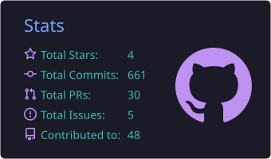
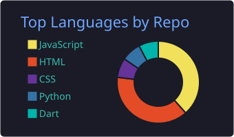
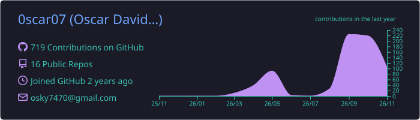

<div align="center">


# ⚡ 0scar07 ⚡


<br>


</div>

---

# 🌌 About Me

```yaml
name: Oscar David
username: 0scar07

education:
  university: Universidad Simón Bolívar
  career: Systems Engineering

located_in: Colombia 🇨🇴

current_focus:
  [
    "Mobile & Web Applications",
    "Developer Tools & Data Visualization",
    "Scientific Computing & Agricultural Modeling",
    "Game Development with Unity",
    "Open Source & Networking"
  ]

currently_learning:
  [
    "Advanced AI",
    "Backend Development",
    "Cloud Computing",
    "Cybersecurity"
  ]

hobbies:
  [
    "Coding",
    "Streaming",
    "Gaming",
    "Research"
  ]
```

---

# 🎧 Spotify Playing

<div align="center">

[](https://github.com/kittinan/spotify-github-profile)

</div>

---

# 🚀 Current Projects

Mobile and web apps, games, developer tools, scientific computing, and networking.
Explore my [portfolio](https://0scar07.github.io/) or browse the projects below.

| Project | What it does | Built with / try it |
| --- | --- | --- |
| 🎮 [Kairo](https://github.com/0scar07/Kairo) | Mobile stats app for nine games, with live matches, favorites, notifications, and multiple languages. | React Native · Expo · Node.js · Express · [Downloads](https://github.com/0scar07/Kairo/releases) |
| 🌐 [Kairo Web](https://github.com/0scar07/kairo-web) | Browser companion for game profiles, live matches, builds, and esports statistics. | React · Vite · [Web app](https://kairo-web.osky7470.workers.dev/) |
| 🌗 [FASE](https://github.com/0scar07/game-off-2026) | A 2.5D puzzle platformer where moving the day/night boundary changes the world. Built for GitHub Game Off 2026. | C# · Unity 6 · [Play on itch.io](https://0scar07.itch.io/game-off-2026) |
| 🎬 [repo-timelapse](https://github.com/0scar07/repo-timelapse) | Turns a repository's Git history into a timelapse video, with releases and contributors. | Node.js · TypeScript · Remotion · [npm](https://www.npmjs.com/package/repo-timelapse) |
| 📽️ [git wrapped](https://github.com/0scar07/git-wrapped) | Generates an 18-second year-in-review video from Git activity, locally or from a public GitHub profile. | Node.js · TypeScript · Remotion · [npm](https://www.npmjs.com/package/git-wrapped-video) |
| 🌱 [Coffea IA — web](https://github.com/0scar07/proyecto-coffea-hma) | Collaborative research app comparing Exponential, Logistic, and Gompertz growth models for coffee plants. | Python · Streamlit · SciPy · Plotly · [Web app](https://proyecto-coffea-hma-tyrvcwqrujxr7ysggkqbb9.streamlit.app/) |
| 📱 [Coffea IA — mobile](https://github.com/0scar07/coffea-ia-mobile) | Mobile app and API for analyzing coffee plant growth using real nursery data and nonlinear curve fitting. | Flutter · Dart · FastAPI · Python |
| 🌐 [NetCorp](https://github.com/0scar07/netcorp-cisco) | Multi-site enterprise network lab: Cisco configurations generated from YAML, with routing, VPNs, and automated validation. | Cisco Packet Tracer · Python · Jinja2 · pytest |
| 🤖 [AgroPredict IA](https://github.com/0scar07/AgroPredictIA) | Agronomic prediction and model-training dashboard, with prediction history and data visualization. | Flask · TensorFlow/Keras · scikit-learn · JavaScript |
| 🏆 [MultiSport Stats](https://github.com/0scar07/MultiSportStats) | Sports scores, schedules, standings, favorites, and match details, with API data and demo fallbacks. | HTML · CSS · JavaScript · [Web app](https://0scar07.github.io/MultiSportStats/) |

### 🎬 Developer Tools in Action

**repo-timelapse** turns Git history into a video. This demo uses sample data.

[](https://github.com/0scar07/repo-timelapse)

Try it in a Git repository: `npx repo-timelapse`.

<details>
<summary>📽️ Watch the git wrapped demo</summary>

An 18-second Git year-in-review, shown here with sample data.

[](https://github.com/0scar07/git-wrapped)

Try it in a Git repository: `npx git-wrapped-video`.

</details>

### 🔓 Open Source Contributions

Merged contributions:

- **DBX:** [Spanish translations](https://github.com/t8y2/dbx/pull/14214) and [SQL editor completion behavior](https://github.com/t8y2/dbx/pull/14216).
- **Magic UI:** [Aligned documented prop defaults with the components](https://github.com/magicuidesign/magicui/pull/1084).
- **League Akari:** [Fixed the compact sidebar drawer's theme surface](https://github.com/LeagueAkari/LeagueAkari/pull/549).

Recent PRs: [React Native Paper accessibility](https://github.com/callstack/react-native-paper/pull/5277) · [DBX plugin translations](https://github.com/t8y2/dbx/pull/15479) · [Android Widget / Expo Router docs](https://github.com/sAleksovski/react-native-android-widget/pull/168).

[View all my open source pull requests](https://github.com/search?q=author%3A0scar07+is%3Apr+-user%3A0scar07&type=pullrequests).

<details>
<summary>🧪 Earlier projects and experiments</summary>

- [API REST Colombia](https://github.com/0scar07/API-REST-COLOMBIA): Barranquilla data dashboard and charts.
- [Api-Rest](https://github.com/0scar07/Api-Rest): collaborative sports dashboard with live scores and standings.
- [IA](https://github.com/0scar07/IA): another iteration of AgroPredict's frontend and Python backend.
- [FirstProject](https://github.com/0scar07/FirstProject): an early personal portfolio built with HTML, CSS, and JavaScript.
- [Flores](https://github.com/0scar07/Flores): an interactive flower animation built with web technologies.
- [Personal portfolio](https://github.com/0scar07/0scar07.github.io): the source for my [portfolio website](https://0scar07.github.io/).

</details>

---

# 🧠 Tech Stack

<div align="center">


</div>

---

# 📊 GitHub Stats

<div align="center">





</div>

---

# 🔥 GitHub Streak

<div align="center">


</div>

---

# ⏱️ Coding Activity

<div align="center">


</div>

---

# 📈 Contribution Graph

<div align="center">



</div>

---

# 🏆 GitHub Trophies

<div align="center">


</div>

---

# 💻 Matrix Rain Effect

<div align="center">


</div>

---

# 🌐 Connect With Me

<div align="center">

<a href="https://github.com/0scar07">

</a>

<a href="https://www.linkedin.com/in/oscar-david-llanos-luna-2104601b8/">
  
</a>

<a href="mailto:osky7470@gmail.com">
  
</a>

</div>


<div align="center">

<pre>
 ██████╗ ███████╗ ██████╗ █████╗ ██████╗  ██████╗ ███████╗
██╔═████╗██╔════╝██╔════╝██╔══██╗██╔══██╗██╔═████╗╚════██║
██║██╔██║███████╗██║     ███████║██████╔╝██║██╔██║    ██╔╝
████╔╝██║╚════██║██║     ██╔══██║██╔══██╗████╔╝██║   ██╔╝
╚██████╔╝███████║╚██████╗██║  ██║██║  ██║╚██████╔╝   ██║
 ╚═════╝ ╚══════╝ ╚═════╝╚═╝  ╚═╝╚═╝  ╚═╝ ╚═════╝    ╚═╝
</pre>

</div>

<div align="center">

### ⚡ Systems Engineering • Universidad Simón Bolívar ⚡

</div>
